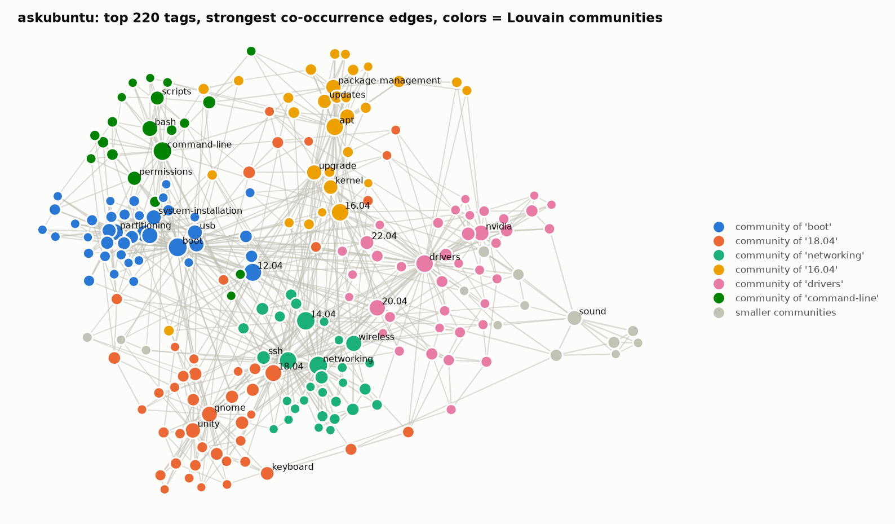
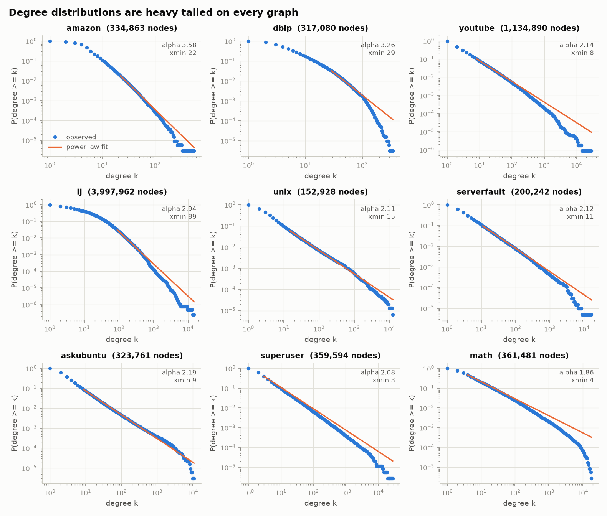
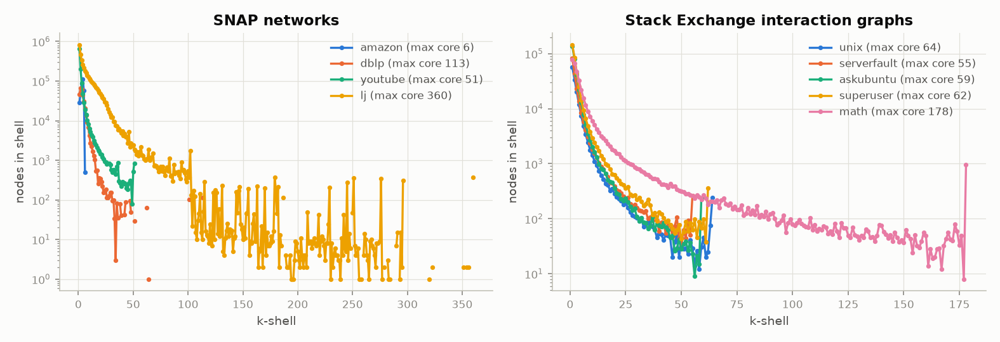
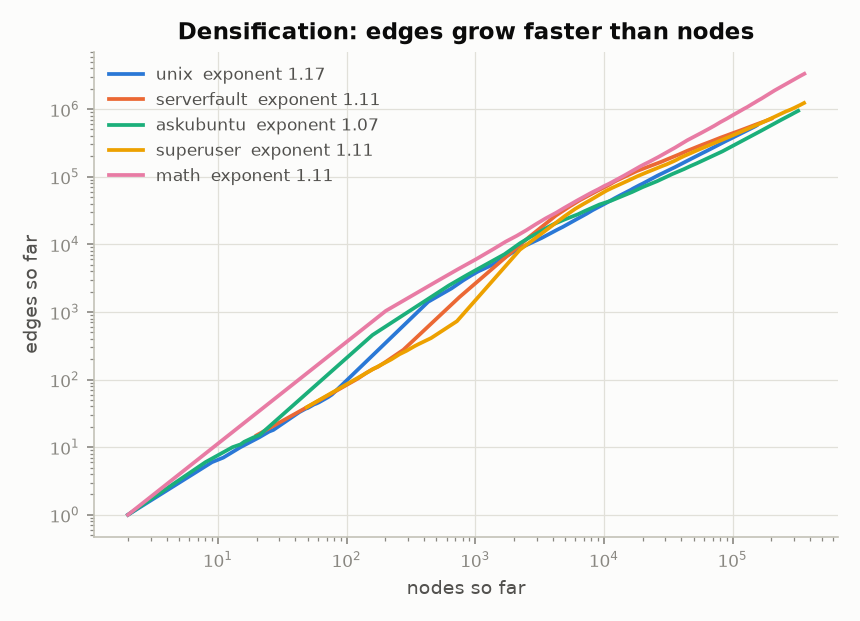
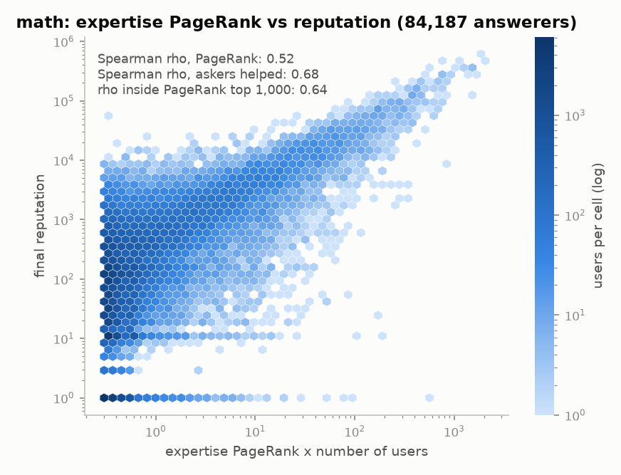
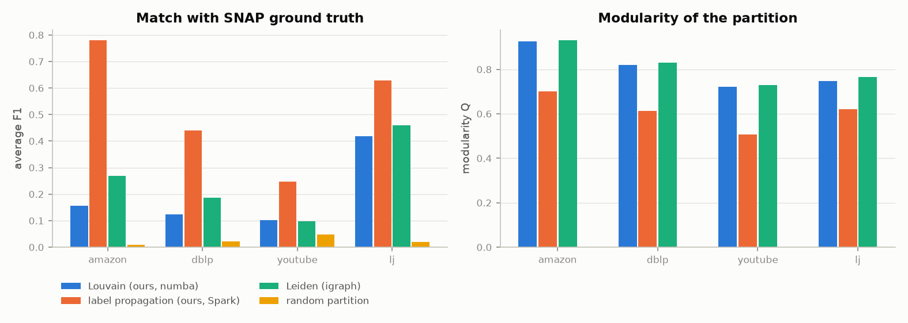
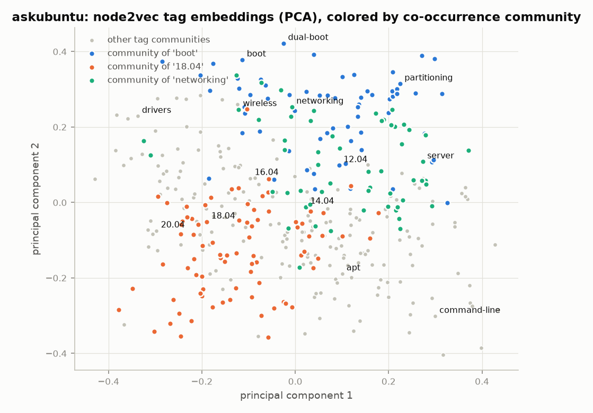
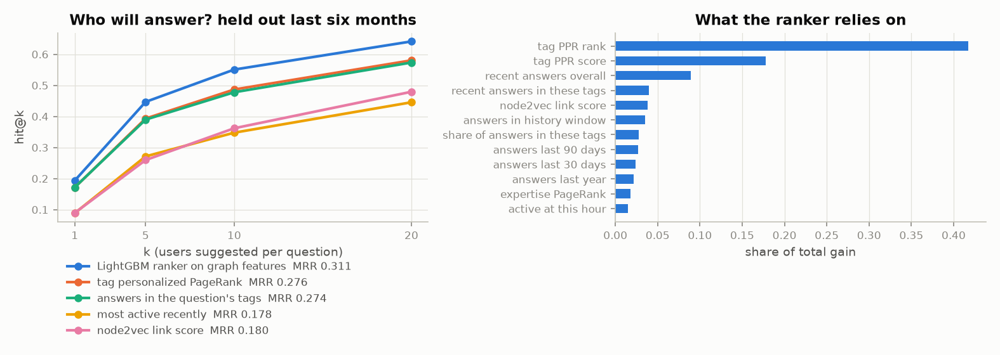
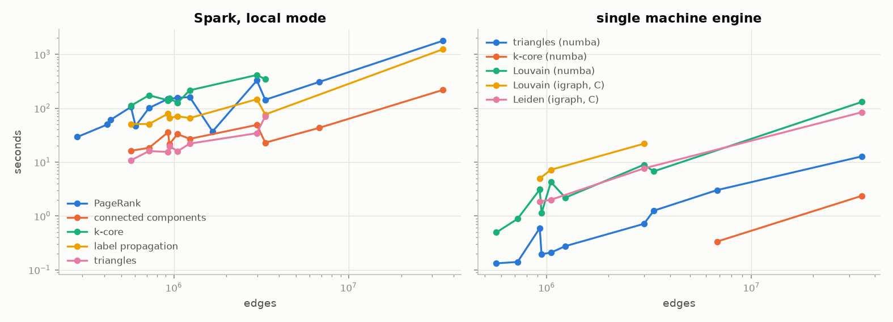
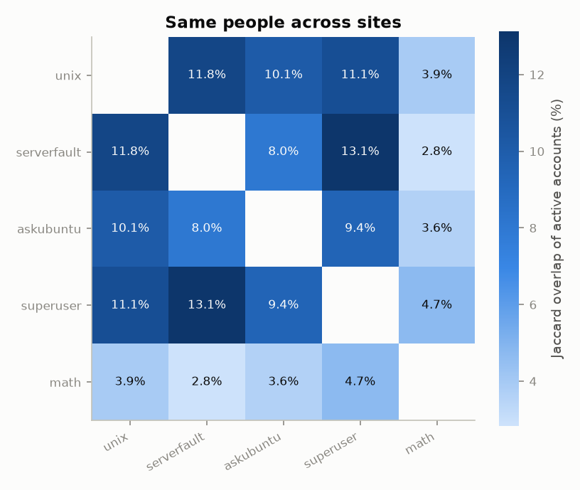

# rookery

[](https://github.com/adwitiyashukla/rookery/actions/workflows/ci.yml)

Graph mining on Stack Exchange and SNAP networks with PySpark.

The Spark side has PageRank, connected components, k-core, label propagation, triangle counting and node2vec random walks. Next to it there is a small single machine engine in numba for triangles, k-core, Louvain and personalized PageRank. I ran everything on five Stack Exchange sites and four SNAP graphs on my laptop (HP OmniBook 5, Core 5 120U, 8 GB RAM). The biggest graph is LiveJournal with 4.0M nodes and 34.7M edges. Every result is checked against igraph, networkx and the counts SNAP publishes. At the end I use the Stack Exchange graphs to predict who is going to answer a new question.



## Data

| Graph | What it is | Nodes | Edges |
|---|---|---|---|
| amazon | SNAP com-Amazon, products bought together | 334,863 | 925,872 |
| dblp | SNAP com-DBLP, co-authors | 317,080 | 1,049,866 |
| youtube | SNAP com-YouTube, friendships | 1,134,890 | 2,987,624 |
| lj | SNAP com-LiveJournal, friendships | 3,997,962 | 34,681,189 |
| unix | unix.stackexchange.com, who answered or commented on whom | 152,928 | 568,319 |
| serverfault | serverfault.com, same | 200,242 | 721,174 |
| askubuntu | askubuntu.com, same | 323,761 | 944,221 |
| superuser | superuser.com, same | 359,594 | 1,233,664 |
| math | math.stackexchange.com, same | 361,481 | 3,335,549 |
| network | all five sites joined by account | 1,140,076 | 6,790,852 |

The Stack Exchange data is the April 2024 dump from archive.org, with 7.4M posts, 12.6M comments and 5.7M users across the five sites. From each site I build an answer graph (answerer to asker), an interaction graph (answers and comments, undirected), a user to tag graph, a tag co-occurrence graph and the duplicate and related post links. The network graph joins the five interaction graphs through the Stack Exchange account id, so a person who is active on two sites is one node. The SNAP graphs come with their top 5000 ground truth communities.

## What runs

| Stage | What it does |
|---|---|
| ingest | 7z dumps to Parquet with Spark's XML reader, SNAP edge lists to Parquet |
| build | the graphs above |
| mine | degrees and a power law fit, PageRank, components, k-core, triangles, clustering |
| crosscheck | every result against igraph and networkx, and the SNAP graphs against SNAP's published counts |
| communities | Louvain, label propagation in Spark, Leiden as a reference, scored against SNAP ground truth |
| embed | node2vec walks in Spark, then word2vec on the walks |
| route | who will answer a question, a LightGBM ranker against simple baselines |
| figures | all the plots in this README |

Spark does triangles and k-core up to 6M edges. LiveJournal and the network graph are bigger than that, so those two go to the numba engine. The whole run takes about 3.5 hours on my laptop.

## Results

### Every number matches the references

| Graph | PageRank, max difference to igraph | Components | k-core | Triangles |
|---|---|---|---|---|
| amazon | 6.4e-09 | same | same on every node | 667,129, same on every node |
| dblp | 1.2e-08 | same | same on every node | 2,224,385, same on every node |
| youtube | 7.2e-08 | same | same on every node | 3,056,386, same on every node |
| lj | 3.0e-08 | same | same on every node | 177,820,130, same on every node |
| unix | 4.3e-08 | same | same on every node | 1,614,328, same on every node |
| serverfault | 2.6e-08 | same | same on every node | 1,446,997, same on every node |
| askubuntu | 1.3e-08 | same | same on every node | 1,410,335, same on every node |
| superuser | 2.6e-08 | same | same on every node | 2,362,304, same on every node |
| math | 2.7e-08 | same | same on every node | 34,605,805, same on every node |
| network | 5.9e-08 | same | same on every node | 43,489,930, same on every node |

PageRank also gives the same top 100 nodes as igraph on all 15 graphs (the five answer graphs are directed and only get PageRank). networkx agrees too on the graphs small enough for it. All four SNAP graphs match the node, edge and triangle counts SNAP publishes, and the average clustering matches to four decimals (0.3967, 0.6324, 0.0808 and 0.2843). `python -m rookery verify` fails as soon as one of these checks stops matching.

### Degrees are heavy tailed everywhere



The power law fits (discrete maximum likelihood, xmin chosen by the KS distance) give exponents between 1.9 and 3.6. LiveJournal comes out at 2.94 above degree 89. The Stack Exchange sites sit between 1.9 and 2.2 because a few people answer thousands of questions.

### k-cores



LiveJournal has a 360-core, a group of people where everyone has at least 360 friends inside the group. math reaches a 178-core, much deeper than the other sites (55 to 64), and the network graph tops out at 178 as well.

### The sites get denser over time



On every site the number of edges grows like the number of nodes to the power 1.07 to 1.17, so people interact with more people as a site grows. This is the densification law from Leskovec, Kleinberg and Faloutsos (2005).

### PageRank vs reputation



On math's answer graph, where the edges point from askers to the people who answered them, expertise PageRank has a Spearman correlation of 0.52 with final reputation over 84,187 answerers. The plain number of askers helped gets 0.68. Reputation follows how many people you helped more than who you helped.

### Communities



Louvain and Leiden find the partitions with the highest modularity, but label propagation matches SNAP's ground truth communities much better (F1 0.78 against 0.16 on Amazon). The ground truth communities are small, and label propagation finds many small groups. My numba Louvain gets the same modularity as igraph's C version (0.9265 vs 0.9262 on Amazon, 0.7217 vs 0.7214 on YouTube) and runs 1.6 to 2.5 times faster. On LiveJournal it takes 131 seconds. My Spark label propagation lands close to igraph's own (F1 0.78 vs 0.81 on Amazon, 0.44 vs 0.45 on DBLP).

On the Stack Exchange interaction graphs label propagation collapses into one giant community on four of the five sites, because a few very active users connect almost everyone. Louvain still finds 600 to 4,250 communities there.

The map at the top of this page is askubuntu's 220 most used tags with their strongest co-occurrence edges, colored by Louvain community.

### node2vec



The walks run in Spark on the user to tag graph (4 walks of length 20 from every node, 98M tokens over all sites and snapshots), then gensim's word2vec learns 64 dimensional vectors. Tags from the same co-occurrence community tend to land near each other, even though the walks never see which tags appear on the same question. They only see which users answer which tags.

### Who will answer a new question?



For each test question the model ranks up to 200 candidate users. The test questions are from October 2023 to March 2024 and every feature is computed from a snapshot frozen on October 1, 2023. Training uses April to September 2023 with a snapshot from April 1. To keep the future out of the features:

- the history only counts answers and comments from before the snapshot date
- questions use the tags they had when they were posted, taken from the post history, because 607K questions got retagged later, sometimes by the person who answered
- node2vec is trained separately for each snapshot
- scores and accepted answers from the 2024 dump are not used, since they include votes cast after the snapshot
- the asker never counts as a candidate, and ties in a score are broken at random

| Method | hit@1 | hit@5 | hit@10 | MRR | NDCG@10 |
|---|---|---|---|---|---|
| **LightGBM ranker on 22 graph features** | **0.193** | **0.447** | **0.551** | **0.311** | **0.344** |
| tag personalized PageRank | 0.171 | 0.393 | 0.487 | 0.276 | 0.300 |
| answers in the question's tags | 0.172 | 0.390 | 0.478 | 0.274 | 0.297 |
| node2vec link score | 0.089 | 0.260 | 0.362 | 0.180 | 0.199 |
| most active recently | 0.089 | 0.271 | 0.348 | 0.178 | 0.194 |

That is 12,539 test questions over the five sites, with math capped at a sample of 4,000. The ranker wins on every site, from 0.346 vs 0.307 hit@10 on math up to 0.747 vs 0.664 on superuser. It leans mostly on personalized PageRank from the question's tags, then on how active a user was recently. The candidate list contains a real answerer for 81.5% of the questions. I only score questions where at least one answerer was active in the two years before the snapshot, which is 86.5% of the answered ones, because nothing can be learned about people with no history.

### Runtime



Spark handles the iterative algorithms on LiveJournal on one laptop. PageRank takes 30 minutes for 36 iterations over 69M directed edges, components take under 4 minutes and label propagation 21 minutes. When a graph fits in memory the numba engine is much faster. It counts all 177.8M triangles of LiveJournal in 12.8 seconds and finds its k-core in 2.4 seconds, while the Spark k-core needs about 7 minutes on the 3M edge YouTube graph.

### Same people across sites



1.18M accounts are active on at least one of the five sites, and 174K of them (14.7%) are active on two or more. serverfault and superuser share the most people, while math barely overlaps with the four computing sites.

## How to run

You need Python 3.11 or newer and Java 17 or 21. On Windows, Spark also needs winutils.exe and hadoop.dll. Put them in a folder like `C:\Users\you\hadoop\bin` and set `HADOOP_HOME` to `C:\Users\you\hadoop`. I used the Hadoop 3.4.0 build from the kontext-tech/winutils repo.

```
git clone https://github.com/adwitiyashukla/rookery.git
cd rookery
python -m venv .venv
.venv\Scripts\activate
pip install -e ".[dev]"
python -m rookery check
python -m rookery fetch
python -m rookery all
python -m rookery verify
```

On Linux or macOS activate with `source .venv/bin/activate` instead. `fetch` downloads about 7.6 GB. `all` runs the stages in the order of the table above, and every stage can also run alone, for example `python -m rookery mine`. Mining, label propagation and the embeddings pick up where they stopped if a run gets interrupted.

To try it without the big download there is a synthetic replica with the same file formats:

```
python -m rookery synth --config config.ci.toml
python -m rookery all --config config.ci.toml
python -m rookery verify --config config.ci.toml
```

That takes about 10 minutes and it is what CI runs.

## Config

Every setting lives in `config.toml`: Spark memory and threads, the sites and SNAP graphs, tolerances and size limits for each algorithm, walk and embedding sizes, and the routing dates and model settings. The file is checked when it loads, and `python -m rookery check` runs only that check.

## Tests

`pytest -q` runs 41 tests. The Spark algorithms are checked against networkx on random graphs, and there are tests for the numba engine, the config checks, the XML ingest and the ranking metrics. GitHub Actions runs ruff, the tests and the full pipeline on the synthetic replica.

## Layout

```
src/rookery/
  cli.py          command line and stage order
  config.py       config loading and checks
  sparkctx.py     Spark session, Java and Hadoop setup
  fetch.py        downloads with resume
  synth.py        synthetic replica of the dumps and SNAP graphs
  ingest.py       7z dumps and SNAP edge lists to Parquet
  build.py        graphs from posts, comments and tags
  sparkgraph.py   graph algorithms in Spark
  localgraph.py   numba engine: CSR, triangles, k-core, Louvain, push PPR
  mine.py         degrees, PageRank, components, k-core, triangles
  crosscheck.py   checks against igraph, networkx and SNAP
  communities.py  Louvain, label propagation, Leiden reference, scoring
  embed.py        node2vec walks in Spark, then word2vec
  routing.py      who will answer: features, ranker, baselines
  figures.py      all the plots
tests/
figures/          the PNGs in this README
config.toml       settings for the real run
config.ci.toml    small settings for the synthetic run
```
